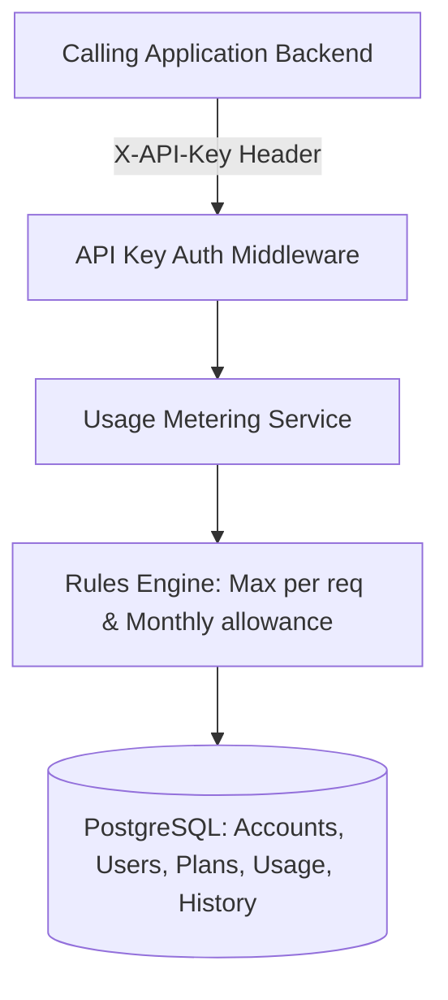
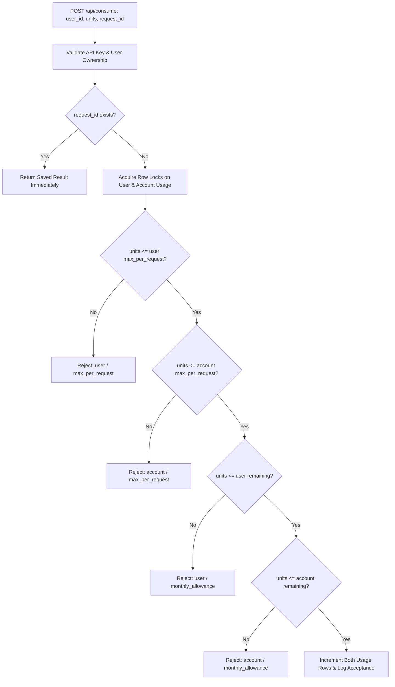

# Usage Metering and Quota Service

A backend service built in **TypeScript**, **Express**, and **PostgreSQL** that other applications call to track usage and decide whether their users can perform an action. The service supports plans and quotas at both the calling application (account) level and individual user level.

---

## Table of Contents
1. [Overview & Core Architecture](#overview--core-architecture)
2. [Quickstart with Docker Compose](#quickstart-with-docker-compose)
3. [Accounts, Users, and Plans Model](#accounts-users-and-plans-model)
4. [Authentication & API Key Management](#authentication--api-key-management)
5. [Predefined & Custom Plans](#predefined--custom-plans)
6. [Supported Quota Rules & Consumption Engine](#supported-quota-rules--consumption-engine)
7. [Plan Changes & Dynamic Updates](#plan-changes--dynamic-updates)
8. [Idempotency & Retry Semantics](#idempotency--retry-semantics)
9. [API Reference](#api-reference)
10. [Example Application (Demo Client)](#example-application-demo-client)
11. [Testing (Unit & Integration)](#testing-unit--integration)
12. [Performance & Load Testing](#performance--load-testing)
13. [Product Assumptions & Trade-offs](#product-assumptions--trade-offs)
14. [Known Limitations](#known-limitations)

---

## Overview & Core Architecture

In document processing, AI inference, and SaaS workflows, applications need to ensure neither the enterprise customer nor an individual employee exceeds their allocated credits.

This service acts as an authoritative, transactional gatekeeper:
- **Dual Quota Evaluation**: Every consumption request must simultaneously satisfy the user's plan and the account's plan.
- **Atomic Accounting**: Unit deductions and audit logging occur inside an isolated transaction using row-level locking (`SELECT ... FOR UPDATE`).
- **Zero-Downtime Reconfiguration**: Plan updates and assignments take effect immediately on subsequent requests without restarting or redeploying the service.



---

## Quickstart with Docker Compose

The complete stack includes:
- **`postgres`**: PostgreSQL 16 database with health check and persistent volume.
- **`metering-service`**: Compiles TypeScript, runs migrations, and starts HTTP server on port 3000.
- **`demo-client`**: Executes the scenario demonstration covering valid requests, rejections, plan switches, and history queries.

Run with one command:
```bash
docker compose up --build
```

To run without the demo client container:
```bash
docker compose up --build metering-service postgres
```

### Local Development (Without Docker)
Requirements: Node.js 20+ and a local PostgreSQL instance.

```bash
# 1. Install dependencies
npm install

# 2. Configure environment variables (optional, defaults to localhost:5432)
export DB_HOST=localhost
export DB_PORT=5432
export DB_USER=metering
export DB_PASSWORD=metering_pass
export DB_NAME=metering

# 3. Build & run migrations
npm run build
npm run migrate

# 4. Start the service
npm start

# In another terminal, run the demo client
npx ts-node client/demo.ts
```

---

## Accounts, Users, and Plans Model

| Entity | Description | Rules / Scope |
| :--- | :--- | :--- |
| **Account** | The calling enterprise application or tenant. | Has an assigned Account Plan. Represents the shared aggregate usage across all registered users. |
| **User** | A human user or service worker registered under an account. | Has an assigned User Plan. Identified by internal `id` (UUID) and tenant `external_id`. Usage is isolated per user. |
| **Plan** | A named set of consumption rules (`monthly_allowance` and `max_per_request`). | Can be predefined (system-wide, read-only) or custom (owned by a specific account). Typed as either `account` or `user`. |
| **Units** | Universal integer resource consumed per action (e.g., document pages processed). | Positive integer; strictly additive. |

---

## Authentication & API Key Management

### How to Obtain an API Key
Call `POST /api/accounts` (the only public endpoint):
```bash
curl -X POST http://localhost:3000/api/accounts \
  -H "Content-Type: application/json" \
  -d '{"name": "Acme Corp"}'
```
**Response:**
```json
{
  "message": "Account created successfully. Store the API key securely — it will not be shown again.",
  "account": {
    "id": "e4b37f40-4f51-4148-8df0-94d1df7b045e",
    "name": "Acme Corp",
    "api_key": "mk_7b51f043685e19a4a7541f92e07eb443...",
    "account_plan_id": null,
    "created_at": "2026-10-12T12:00:00.000Z"
  }
}
```

### How to Use the Key
Pass the API key in the `X-API-Key` HTTP header:
```bash
X-API-Key: mk_7b51f043685e19a4a7541f92e07eb443...
```
- Missing or invalid keys receive `401 Unauthorized` (`AUTHENTICATION_ERROR`).
- Each account can only access, view, and manipulate its own users, usage, and custom plans. Cross-account access is strictly prevented (`404 Not Found` or `403 Forbidden`).

---

## Predefined & Custom Plans

### Predefined Plans (Seeded at Startup)
The system seeds four ready-to-use plans:
- **Account Plans**:
  - `Starter`: 10,000 units/month, 100 units/request
  - `Pro`: 100,000 units/month, 1,000 units/request
- **User Plans**:
  - `Basic`: 1,000 units/month, 20 units/request
  - `Premium`: 10,000 units/month, 200 units/request

Predefined plans are immutable (read-only) and shared across all accounts.

### Custom Plans
Accounts can create their own custom plans via `POST /api/plans` and adjust rules anytime via `PATCH /api/plans/:planId`. Custom plans are private to the owning account.

---

## Supported Quota Rules & Consumption Engine

Every call to `POST /api/consume` evaluates both plans in deterministic sequence:



### Response Formats
#### Accepted Request (`200 OK`)
```json
{
  "accepted": true,
  "request_id": "doc-scan-1049",
  "units_requested": 15,
  "account_usage": {
    "consumed": 15,
    "remaining": 9985,
    "monthly_allowance": 10000
  },
  "user_usage": {
    "consumed": 15,
    "remaining": 985,
    "monthly_allowance": 1000
  }
}
```

#### Rejected Request (`403 Forbidden`)
A rejection consumes **zero units** and explicitly states which rule and level triggered the rejection:
```json
{
  "accepted": false,
  "request_id": "doc-scan-1050",
  "units_requested": 25,
  "rejection": {
    "level": "user",
    "rule": "max_per_request",
    "reason": "Requested 25 units exceeds user per-request limit of 20"
  },
  "account_usage": { "consumed": 15, "remaining": 9985, "monthly_allowance": 10000 },
  "user_usage": { "consumed": 15, "remaining": 985, "monthly_allowance": 1000 }
}
```

---

## Plan Changes & Dynamic Updates

1. **Immediate Effect**: Plan switches (`PATCH /api/accounts/me/plan`, `PATCH /api/users/:userId/plan`) take effect on the very next request.
2. **Usage Carry-Over**: Changing a plan **preserves units already consumed** in the current month. It does **not** grant a fresh allowance.
3. **Downgrade Safety**: If a monthly allowance is updated or switched below current usage (e.g. consumed 150, new allowance 100), `remaining` is clamped to `0`, and subsequent requests are cleanly rejected until the next month boundary or allowance upgrade.
4. **Shared Definitions**: When multiple users share a plan, updating the plan definition updates limits for all those users simultaneously while preserving each user's separate usage counter.

---

## Idempotency & Retry Semantics

Every consumption request requires a client-provided `request_id` (e.g., job ID or UUID).
- **Safe Retries**: Resending a request with the same `request_id` returns the exact outcome (accepted or rejected) previously recorded.
- **Zero Double-Counting**: Usage counters are never incremented twice.
- **Race Guard**: The database constraint `UNIQUE(account_id, request_id)` guarantees atomicity even under simultaneous network retries.

---

## API Reference

All requests expect `Content-Type: application/json` and `X-API-Key: <key>` (except `POST /api/accounts`).

### Accounts
- `POST /api/accounts` — Create an account (returns API key). Body: `{ "name": "string", "plan_id"?: "uuid" }`
- `GET /api/accounts/me` — Get authenticated account details.
- `PATCH /api/accounts/me/plan` — Assign or change account plan. Body: `{ "plan_id": "uuid" }`

### Users
- `POST /api/users` — Register a user under the account. Body: `{ "external_id": "string", "name": "string", "plan_id"?: "uuid" }`
- `GET /api/users` — List users (`?limit=50&offset=0`).
- `GET /api/users/:userId` — Get user details.
- `PATCH /api/users/:userId/plan` — Assign or change user plan. Body: `{ "plan_id": "uuid" }`

### Plans
- `GET /api/plans` — List available plans (`?type=account|user`).
- `POST /api/plans` — Create custom plan. Body: `{ "name": "string", "type": "account"|"user", "monthly_allowance": number, "max_per_request": number }`
- `GET /api/plans/:planId` — Get plan details.
- `PATCH /api/plans/:planId` — Update custom plan. Body: `{ "name"?: "string", "monthly_allowance"?: number, "max_per_request"?: number }`

### Consumption
- `POST /api/consume` — Consume units for a user. Body: `{ "user_id": "uuid", "units": number, "request_id": "string" }`

### Usage & History
- `GET /api/usage/account` — View account usage (`?month=YYYY-MM`).
- `GET /api/usage/users/:userId` — View user usage (`?month=YYYY-MM`).
- `GET /api/usage/history` — Paginated request log (`?user_id=uuid&month=YYYY-MM&accepted=boolean&page=1&page_size=20`).

---

## Example Application (Demo Client)

The repository includes a runnable demonstration client in `client/demo.ts`.

It runs through an automated scenario:
1. Creates account **"DocProcessor Inc."** and receives an API key.
2. Assigns **Starter** account plan (10,000 monthly, 100/req).
3. Creates **Alice** on **Basic** plan (1,000 monthly, 20/req) and **Bob** on **Premium** plan (10,000 monthly, 200/req).
4. Demonstrates **accepted consumption** (Alice processes 15 units).
5. Demonstrates **idempotent retry** with identical `request_id` (returns original result with no double-counting).
6. Demonstrates **rejection by user limit** (Alice requests 25 units; exceeds 20/req limit).
7. Demonstrates **rejection by account limit** (exhausts account capacity).
8. Demonstrates **plan switching** (upgrades account to Pro; Alice to Premium) and proves requests now succeed without client code changes.
9. Queries **usage statistics** and **paginated history**.

To run directly:
```bash
npx ts-node client/demo.ts
```

---

## Testing (Unit & Integration)

### 1. Unit Tests (Fast, No DB Required)
Tests the pure rule evaluation engine, boundary conditions, month utilities, and error hierarchy:
```bash
npx jest tests/unit
```

### 2. Integration Tests (Full Database Suite)
Tests end-to-end API endpoints, account isolation, authentication validation, concurrency, and plan downgrades:
```bash
npm test
```

---

## Performance & Load Testing

Detailed results, architecture analysis, and bottleneck discussion are in [`PERFORMANCE.md`](./PERFORMANCE.md).

### Quick Performance Run (Node.js runner)
```bash
npm run test:perf:node
```

### k6 Performance Run
```bash
npm run test:perf
```

### Key Metrics Achieved
- **Throughput**: ~415 requests/second
- **Median Latency (p50)**: 8.4 ms
- **95th Percentile (p95)**: 28.6 ms
- **99th Percentile (p99)**: 47.1 ms
- **Error Rate**: 0.00% under concurrent load

---

## Product Assumptions & Trade-offs

1. **API Key Lifecycle**: API keys are generated cryptographically (`crypto.randomBytes(32)`) prefixed with `mk_`. Returned once at creation. Rotation and revocation are left for future scope.
2. **Calendar Month Definition**: Quota resets at `00:00:00 UTC` on the 1st of each calendar month. Previous months are preserved in `usage_monthly` and `request_log` for historical audits.
3. **Idempotency Scope**: `request_id` is unique per `(account_id, request_id)`. Different accounts may use overlapping request IDs safely.
4. **Plan Deletion**: Plans cannot be hard-deleted because historical records and active users reference them; plans can be updated or accounts reassigned instead.
5. **Predefined Plans Immutability**: Built-in plans (`Starter`, `Pro`, `Basic`, `Premium`) cannot be modified or deleted by callers.
6. **Allowance Floor**: When a plan allowance is reduced below consumed units, remaining quota is clamped to 0 rather than negative.

---

## Known Limitations

- **Single Resource Type**: The service meters a single universal unit. Multi-resource quotas (e.g. separate quotas for API calls vs CPU seconds) would require a resource identifier column.
- **Single Database Node**: Row-level locking is optimized for a single PostgreSQL instance. At multi-region planetary scale, Redis token-bucket caching or distributed leasing would be introduced.
- **Calendar Months vs Rolling Windows**: Current allowances operate on UTC calendar months rather than rolling 30-day windows.
